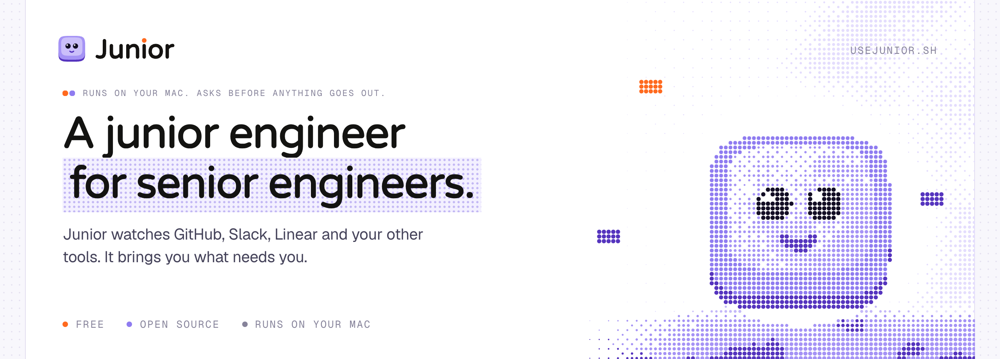
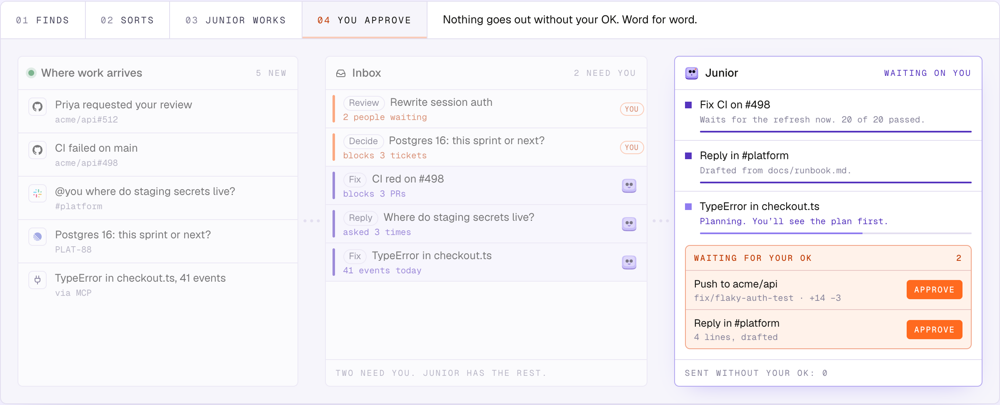

<a href="https://usejunior.sh">
  
</a>

<p align="center">
  <a href="#install">Install</a> ·
  <a href="#how-it-works">How it works</a> ·
  <a href="#the-rules">The rules</a> ·
  <a href="#features">Features</a> ·
  <a href="#fair-questions">FAQ</a> ·
  <a href="#development">Development</a> ·
  <a href="https://usejunior.sh">Website</a>
</p>

<p align="center">
  <a href="https://github.com/usejunior-sh/junior/releases/latest"></a>
  
  
  <a href="https://github.com/usejunior-sh/junior/commits/main"></a>
</p>

<sub>RUNS ON YOUR MAC. ASKS BEFORE ANYTHING GOES OUT.</sub>

## A junior engineer for senior engineers.

Junior watches GitHub, Slack, Linear and your other tools. It brings you what needs you. It takes the rest, and asks before anything goes out. It runs on your Mac, learns how you work, and needs you a little less each week.

```sh
curl -fsSL https://usejunior.sh/install.sh | sh
```

<sub>Installs Junior.app for macOS, Apple silicon or Intel. <a href="install.sh">Read install.sh first.</a> We would.</sub>

<sub>Junior was called Triage until October 2026. Same app, one name now. Updating from Triage moves your data from <code>~/.triage</code> to <code>~/.junior</code> on first start.</sub>



<p align="center"><sub>Example work. Your Tuesday will have more of it.</sub></p>

## Why Junior

**Junior brings you what needs you. And takes what doesn't.** On your Mac, with your tools, and it asks before anything goes out.

- **Only what needs you.** GitHub, Slack, Linear and anything with an MCP server, in one ranked list. Each item says why it's there. People waiting go to the top.
- **Junior takes the rest.** Junior fixes, retries and waits on CI. It drafts replies and runs your chores on a schedule. You approve what goes out.
- **Your Mac, your plan.** Junior runs on your Mac, on the Claude Code or Codex plan you already pay for. No API keys to paste. No bill from us.

Every row in the inbox belongs to you or to Junior.

| You, today | What changes | Whose it is |
| --- | --- | --- |
| "I check five tools to find what needs me." | One ranked list, with a reason on each item. | You, faster |
| "My teammates wait while I dig." | People waiting go to the top. | You, faster |
| "I open PRs and tickets cold." | Ask for a brief and start with the context. | You, faster |
| "I babysit PRs and CI." | Junior fixes, retries and waits on CI. You approve what goes out. | Junior |
| "I do the same chores every week." | Junior runs them on a schedule. | Junior |
| "I keep writing the same replies and updates." | Junior drafts them. They wait for your OK. | Junior |

## How it works

Three steps. One of them is reading a shell script.

**01 · Install the Mac app.** One line in Terminal. The app isn't notarized yet, so read [install.sh](install.sh) first. We would.

```sh
$ curl -fsSL https://usejunior.sh/install.sh | sh
→ Junior.app installed
→ junior, junior-mcp in ~/.local/bin
```

**02 · Connect your tools.** GitHub and Slack out of the box. Anything with an MCP server through a job. Junior uses the logins you already have.

**03 · Hand Junior the rest.** One line, not an essay. Junior reads it back, plans, then works. You approve what goes out.

> **You:** Bump the deps, same as last week.<br>
> **Junior:** Patch versions only, PRs wait for you. Same as last week.

### A hand-off, start to finish

Nothing goes out without you. Junior plans first and asks before anything goes out.

1. **You hand it over in one line.** A pointer, not an essay. "Fix the flaky test on #498" is plenty. Junior opens the PR, the logs and the history itself.
2. **Junior reads it back and asks once.** Everything it needs, in one message, each question with a suggested answer. Often you just say yes.
3. **Junior plans before it touches code.** You review the plan like a PR. Small jobs skip this, because nobody needs a plan for a typo.
4. **Junior works on your Mac.** Edits, tests and local commits don't need your OK. They stay on your machine until you say otherwise.
5. **You approve what goes out.** Pushes, PRs, comments and messages wait for you, word for word. Junior has never posted in #general on its own. It isn't allowed to.

## The rules

**Three rules it can't switch off.** Rename it, change its voice. The rules stay.

1. **It reads back what you ask.** Before it starts, it says what it understood, in a line or two. A misunderstanding costs one message, not an afternoon.
2. **It asks everything in one message.** No drip of questions. One message, and each question comes with the answer it suggests. Often you just say yes.
3. **Nothing leaves without your OK.** Pushes, PRs, comments, ticket moves and messages wait for you, word for word. Edits, tests and local commits don't.

> **You:** Bump the deps on api.<br>
> **Junior:** Reading it back: patch and minor bumps in acme/api, one PR, tests green first.

## Features

The rest of the job. What happens between the inbox and the push.

| | |
| --- | --- |
| **Inbox** | GitHub, Slack, Linear and anything with an MCP server, in one ranked list. Each item says why it's there. People waiting go to the top. The ranking is plain rules, not a model's mood. |
| **Today** | Your morning, already sorted. Junior's morning brief and a shared plan for the day: what's yours, what's Junior's, what's overdue. |
| **Goals** | Hand over the outcome, not the steps. Give Junior a done-when. It waits on CI and reviewers, fixes and retries, and stops at your budget. |
| **Jobs** | Chores that do themselves. Standing assignments on a schedule, set up by chatting with Junior. Each one gets a trial run before you turn it on. |
| **Review nits** | Your PR, minus the nits. It reads the comments on your PR, makes the changes and shows you the diff before it pushes. |
| **Replies** | Same answers, fewer keystrokes. Junior drafts them. They wait for your OK. |
| **Briefs** | Never open a PR cold. Ask for a brief and start with the context. It reads the diff, the thread and the history, and says where to look first. |
| **Log** | Every send waits on a card for your OK, word for word. The log shows what went out and who allowed it. |
| **Sessions** | Full Claude Code chats, Codex chats too, and real terminals in the same workspace. Junior checks its UI work in a browser pane you can watch. |
| **Receipts** | Every automated run is a session you can open. "Found nothing" means it looked and found nothing. |
| **Workspaces** | Work and personal stay apart: separate inbox, jobs, connectors and Claude login. |

## Its face

**Its face says what it's doing.** Eight moods, each one a state. If it looks worried, something needs you.

| Mood | What it means |
| --- | --- |
| Hello | Nothing needs you right now. |
| Listening | You're typing. It's reading. |
| Thinking | Reading the PR, the logs and the thread. |
| Working | On it. Nothing has left your Mac. |
| Needs you | One question, with its suggested answer. |
| Done | Finished. Anything outbound is waiting for your OK. |
| Stuck | Something broke. It says what, instead of guessing. |
| Asleep | Your Mac is asleep. So is Junior. |

## Over time

**Over time, Junior takes work end to end.** Junior starts with the legwork. As it learns how you work, it takes on more of each job, until it can go from the issue to a merged PR.

| Step | Day 1 (today) | After a few weeks · planned | Later · planned |
| --- | --- | --- | --- |
| Find the issue | Junior | Junior | Junior |
| Write the fix | Junior, you review the diff | Junior, you skim the diff | Junior |
| Open the PR | Junior drafts it, you approve | Junior, within your rules | Junior |
| Get it green | Junior fixes CI, you approve replies | Junior | Junior |
| Merge | You | You | Junior, for work you've trusted it with |

Only Day 1 is built. The other two columns are the plan, and they say so.

Junior moves up a step only when you say so. It asks with its track record:

> You approved my last 12 dependency PRs unchanged. Want me to merge these myself?

## Who it's for

Senior and staff engineers, and tech leads who still write code. They use Claude Code or Codex every day, work on a Mac, and have teammates waiting on them.

**Not for (yet):** teams that want a shared fleet of cloud agents, people who want AI to act without review, and anyone not on a Mac.

Better you read that here than after the install.

## Fair questions

The site has the short answers. These are the long ones.

**Will Junior post as me?**<br>
Not without your OK. PRs, comments, ticket moves and messages wait on a card, word for word. Edits, tests and local commits don't need it, because they stay on your Mac. Two things go without a card, because nobody else sees them yet: a push to your own branch, and a draft PR. A push to the default branch waits like any send. So does a plain force push. Commands that destroy work still ask.

You can also approve a send in advance: one person, one kind of send. "Junior may DM Priya when a PR is ready." Junior proposes these on a card. You add and revoke them in Settings → Approvals.

**Will Junior replace me?**<br>
It asks before it pushes a branch. You're fine.

**Is Junior its own AI model?**<br>
No. Junior is Claude Code, or Codex for chats, running with your login. The name, the face and the rules are ours.

**Does it work while my Mac sleeps?**<br>
No. Junior runs on your Mac and stops when it sleeps, like the rest of us. Junior starts again after a reboot. Scheduled jobs that couldn't run are recorded as missed, not quietly dropped. Quitting the window doesn't stop it either. A LaunchAgent keeps the server up.

**What do I need?**<br>
A Mac, Apple silicon or Intel. Claude Code, installed and logged in. Codex works too, for chats. The full list is under [Install](#install).

**Which tools can it watch?**<br>
GitHub and Slack out of the box. Linear, Sentry, Notion or anything with an MCP server comes in through a job. You set up a job by chatting with Junior. Details under [What feeds it](#what-feeds-it).

**Where does my data live?**<br>
On your Mac, under `~/.junior`. Junior holds no GitHub, Slack or Linear credentials; it uses the logins you already have. What you send to Claude, Codex or a connector still goes to that service. We won't pretend otherwise. More under [Privacy](#privacy).

**What does it cost?**<br>
Nothing. Junior is free and open source, under the MIT licence. Junior runs on your own Claude or Codex plan, and each session shows what it cost, in dollars.

**Can it merge PRs?**<br>
Not today. You merge. Later, for work you've trusted it with, and only when you say so.

**What happens when it gets stuck?**<br>
It stops and asks, with the answer it suggests. Its face says Stuck, so you'll notice before standup.

**Why install from Terminal?**<br>
The app isn't notarized by Apple yet, so a browser download would get blocked. The script installs it properly. [Read install.sh first](install.sh). We would.

## Install

**Let Junior do the triage.** One line installs it. Free and open source, on the Claude Code or Codex plan you already pay for. No account, no card.

```sh
curl -fsSL https://usejunior.sh/install.sh | sh
```

Run the same line again to update. Junior.app brings its own Node, so there's nothing to install from npm. On launch it attaches to the Junior already running, or starts one. More in [desktop/README.md](desktop/README.md).

| You need | Why |
| --- | --- |
| macOS, Apple silicon or Intel | Junior is a Mac app |
| [Claude Code](https://claude.com/claude-code), logged in | Junior, jobs and briefs run on your login, not an API key |
| `gh`, logged in | the GitHub source · optional |
| claude.ai Slack connector | the Slack source · optional |
| Codex, logged in | Codex chats · optional |

The installer also puts `junior` and `junior-mcp` in `~/.local/bin`. The `junior` command is safe to run any time.

```sh
junior             # start if not running, print the URL
junior status      # version, build, port, live sessions
junior restart     # how an update takes effect
junior stop        # stop it (ends live sessions)
junior logs        # tail the server log
junior doctor      # check node, claude, gh, the agent and the server
junior add "Look at the flaky deploy check"   # file a to-do from any terminal
```

<kbd>⌘</kbd> <kbd>⇧</kbd> <kbd>T</kbd> does the same from anywhere on your Mac.

> Early software. Expect rough edges and the odd breaking change.

## What feeds it

| Source | How | What arrives |
| --- | --- | --- |
| GitHub | built in, through your `gh` login | review requests, your PRs by state, mentions |
| Slack | built in, through your claude.ai connector, read-only | unread DMs and mentions |
| Linear, Sentry, PagerDuty, Notion… | a job, through any MCP server Claude Code can see | whatever the job is told to look for |
| The web | a job, with Claude Code's own search and fetch | pages a job finds |
| You | the composer, <kbd>⌘</kbd><kbd>⇧</kbd><kbd>T</kbd>, `junior add`, or MCP | anything |

Every item has a canonical id. The same PR asked about in Slack and requested on GitHub is one row, not two.

A job is what you would tell a colleague: where to look, what counts, how often. You don't fill in a form. You tell Junior. It reads the job back, asks once, and drafts it switched off. A trial run shows what it would file. Then you turn it on. Each job gets only the tools you grant it.

## Connect your own agent

Junior's tools work from any Claude Code, Codex or Cursor session.

```sh
claude mcp add junior -- junior-mcp                 # stdio
# or point a client at http://localhost:5178/mcp    # streamable HTTP
```

Settings → MCP shows the URL for the workspace you're in, and the one command each client needs. The tools cover the inbox, today's plan, artifacts and job drafts. Upserts are idempotent and never overwrite your own state, so a scanner can't create duplicates or undo a "done".

## Privacy

Everything runs on your Mac. Data lives in SQLite under `~/.junior`, one database per workspace. The server answers only this machine, unless you pair a phone in Settings → Phone. Sources go through your `gh` login and your claude.ai connectors. Junior, jobs and briefs spend your Claude or Codex plan, and the app shows what each one cost.

## Development

```sh
git clone https://github.com/usejunior-sh/junior && cd junior
npm install
npm run dev          # server on :5188, Vite on :5189. Open the Vite URL.
```

Dev keeps its data in `~/.junior-dev`, so your migrations never touch your real inbox.

The server is not run under a file watcher on purpose: restarting it kills live Claude subprocesses. Restart it by hand after changing `server/`. `npm run typecheck` covers both halves, `npm test` runs the unit tests, and `npm run smoke` is the end-to-end check against a running server.

| Path | What lives there |
| --- | --- |
| `shared/protocol.ts` | the WebSocket contract, imported by both sides |
| `core/` | the store, scoring, jobs, teams and goals, sources |
| `server/` | HTTP and WebSocket server, the `junior` and `junior-mcp` bins |
| `web/` | Vite + React UI |
| `desktop/` | Junior.app, the Electron window over the server |

---

<p align="center"><b>Only the work that needs you should reach you.</b></p>

<p align="center">
  <sub>
    <a href="https://usejunior.sh">usejunior.sh</a> ·
    <a href="https://usejunior.sh/changelog">Changelog</a> ·
    <a href="https://github.com/usejunior-sh/junior/issues">Issues</a> ·
    MIT licence
  </sub>
</p>

<p align="center"><sub>Junior drafted this README. Samar approved it.</sub></p>
